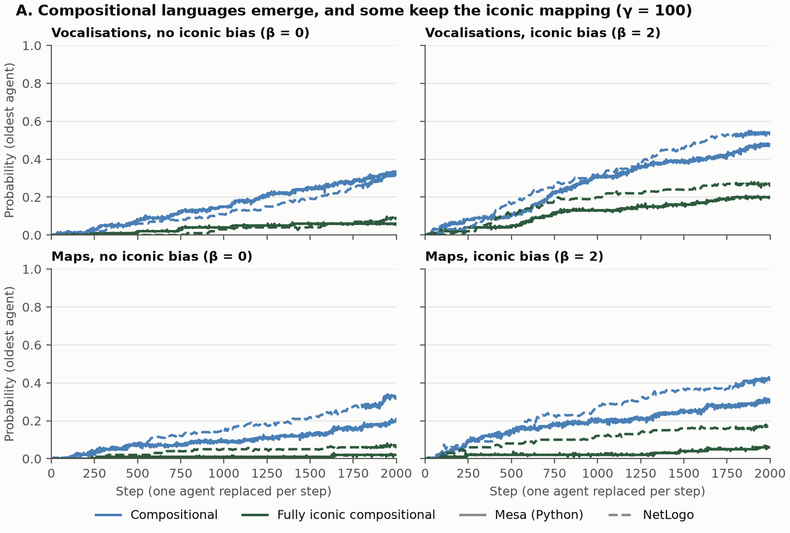
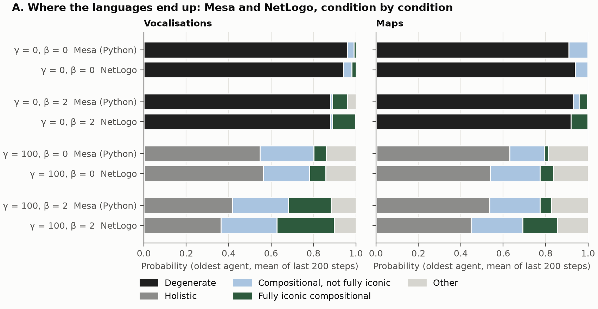
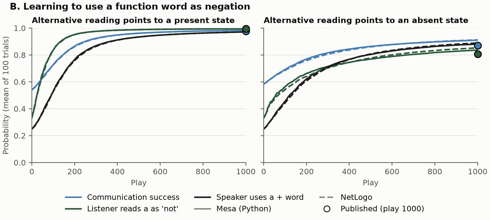
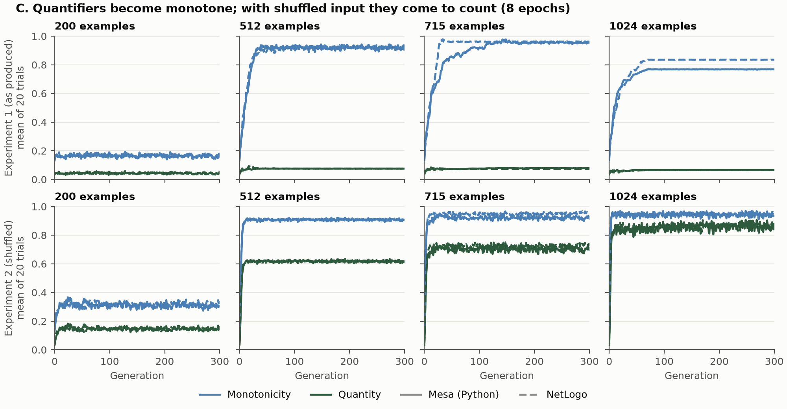
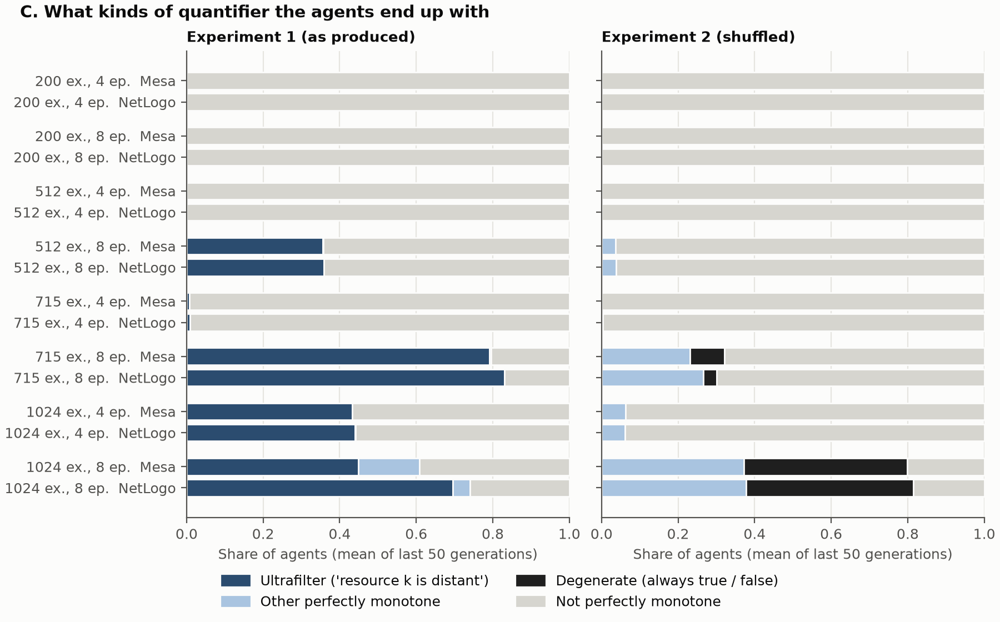

# The Iconographers

Agent-based models of a scenario in the evolution of language. A community, the *iconographers*, refers to four resources with vocalisations and maps that start out iconic: back rounded vowels and large round glyphs for resources that are large, round or distant; front unrounded vowels and small angular glyphs for resources that are small, angular or near. The models ask whether such a community arrives at compositional expressions that remain iconic (whether language can become abstract without becoming arbitrary) and whether it can learn to negate and to quantify. 

Each submodel is a published model from evolutionary linguistics and gets applied to the iconographers' resources and implemented twice from one specification, in Python (Mesa) and in NetLogo. The two implementations do not share code, so wherever there is model agreement, it does not depend on a particular program.

## Submodels

| | Question | Published model | Python (Mesa) | NetLogo |
|---|---|---|---|---|
| A | Do vocalisations and maps become compositional, and do they remain iconic? | Kirby et al. (2015); Kirby & Tamariz (2022) | `src/iconographers/abm.py` | `netlogo/iconographers.nlogo` |
| B | Can a function word come to mean "not"? | Steinert-Threlkeld (2016, 2017) | `src/iconographers/negation.py` | `netlogo/negation.nlogo` |
| C | Do quantifiers become monotone and number-based? | Carcassi et al. (2021) | `src/iconographers/quantifiers.py` | `netlogo/quantifiers.nlogo` |

- **A. Compositional expressions.** Ten Bayesian learners with generational turnover; the eldest teaches. Each resource combines two features (large-and-round or small-and-angular; distant or near), and each expression has two symbols, giving 256 possible languages. The prior favours languages with short grammars; speakers avoid ambiguous expressions with strength γ. An optional iconic bias shortens the description of a language by β bits per iconic expression. Maps differ from vocalisations in what counts as iconic and in being kept: learners also learn from a record of maps made by agents who have since died. A Markov-chain version of the same rules (`src/iconographers/chain.py`; Griffiths & Kalish, 2007) gives the expected long-run outcome.
- **B. Negation.** A signalling game with Roth–Erev reinforcement over eight states, each resource present or absent. The listener learns whether a function word *a* is to be ignored, forms a new word with the word it precedes, or negates it.
- **C. Quantifiers.** Neural-network agents in an iterated-learning chain judge which of the 1,024 configurations of ten resources (each distant or not) make a quantified statement true. Experiment 2 scrambles the order of the resources for each learner, so that no quantifier can track a particular resource.

The scenario names a third pressure towards sentential structure, the ascription of knowledge and error to others. It is not modelled here. The three submodels are not linked. The full model specification follows the ODD protocol (Grimm et al., 2020): [ODD.md](ODD.md).

## Principal results

All results are descriptive: means over 100 runs (A, B) or 20 runs (C). Complete tables, with standard deviations, are in [results/README.md](results/README.md). In the figures, solid lines are Python and dashed lines NetLogo.

**A. Compositional expressions emerge, and are iconic more often than chance.**
- Without communicative pressure (γ = 0), one expression for everything dominates (88–96% of the outcome in both implementations), as Kirby et al. (2015) report. With it (γ = 100), compositional languages, one part for size and shape and one for distance, emerge gradually and are still spreading after 2000 steps; in the Markov-chain version they take over.
- With the iconic bias (β = 2), compositional languages are fully iconic more often than chance: for vocalisations 43% (Python) and 51% (NetLogo), against 25%; for maps 18% and 40%, against 12.5%. This is partly built in, since the only unambiguous, fully iconic languages are compositional.
- The bias raises the compositional share after 2000 steps in both implementations (vocalisations: 0.46 against 0.31 in Python, 0.53 against 0.29 in NetLogo). In the Markov-chain version it slightly lowers it; which difference between the two models is responsible has not been tested.
- Whether maps, being records, change more slowly than vocalisations is not settled. Without the bias, maps lag behind in Python (0.18 against 0.31 compositional) but not in NetLogo (0.30 against 0.29).





**B. A word for "not" is learned.** After 1000 exchanges, the listener reads *a* as negation with probability 0.995 in both implementations when the alternative readings are always wrong (published: 0.995), and with probability 0.84 (Python) and 0.85 (NetLogo) when one of them is sometimes right (published: 0.81; Steinert-Threlkeld, 2017, Table 2.2).



**C. Quantifiers become monotone, and count only when resources cannot be tracked.**
- Given enough learning (512 examples per learner with 8 passes of training, or 1024 with 4), quantifiers become *monotone*, as simple natural-language quantifiers generally are: monotonicity exceeds 0.9 in all such settings but one.
- Without scrambling, the monotone quantifiers are almost all of the form "resource k is distant", which does not count (quantity at most 0.08, as for random networks).
- With scrambling, such quantifiers disappear and quantity, the degree to which a judgment depends only on the number of distant resources, rises to 0.86 (Python) and 0.87 (NetLogo).
- Both conclusions of Carcassi et al. (2021) are reproduced qualitatively; the paper's figures were not compared value by value.





**Agreement between the implementations.** Python and NetLogo agree within run-to-run variation in all three submodels. The two largest differences have identified sources. In A, Python reuses its seeds across conditions and so starts every condition from the same sample of holistic languages, which carries through to the end. In C, Experiment 1 with 1024 examples and 8 passes, runs end in one of two ways, and the implementations differ in how many runs end each way. Details are in [results/README.md](results/README.md).

## Limitations

- *No inferential tests.* In A, differences in the compositional share below about 0.13 lie within seed-to-seed variation (twice the standard error of a difference between two means of 100 runs, with standard deviations around 0.45).
- *β = 2 is illustrative.* There is no empirical estimate of the strength of an iconic bias in these terms; the comparison is the same model with β = 0.
- *Submodel A is partly iconic by construction,* as stated above.
- *B and C contain no iconicity,* because the published models contain none. They show that negation and quantification can be learned and transmitted, not that they grew out of iconic expressions.
- *Departures from the published models,* documented in ODD.md: in B, the speaker in an absent state chooses only among "*a* + word" signals, as in the thesis's reference code (§8); in C, one of three worked values of the quantity measure in the paper is not reproduced (0.729 against 0.7517, §9).

## Repository structure

| Path | Content |
|---|---|
| `ODD.md` | Model specification (ODD protocol), the scenario element by element, predictions, sources |
| `src/iconographers/` | Python implementation. A: `languages.py`, `kirby2015_priors.py` (language space, prior, iconicity), `learning.py` (learning, production), `abm.py` (agent-based model), `chain.py` (Markov chain). B: `negation.py`. C: `quantifiers.py` |
| `netlogo/` | NetLogo implementation of the three submodels; `experiments/` holds the BehaviorSpace designs |
| `scripts/` | Python designs (`run_*.py`), the headless NetLogo runner (`run_netlogo.sh`), NetLogo summaries (`summarise_netlogo.py`), figures (`make_figures.py`) |
| `tests/` | 32 tests, including checks against published values and numerical gradients |
| `results/` | All outputs and figures, documented in `results/README.md` |

## Reproduction

Requirements: [uv](https://docs.astral.sh/uv/) for Python; NetLogo 7.0.4 for the NetLogo designs.

```sh
uv sync                                    # Python environment from uv.lock
uv run pytest                              # 32 tests (about 20 seconds)
uv run python scripts/run_abm.py           # A: 4 conditions x 100 runs x 2000 steps
uv run python scripts/run_chain.py         # A: Markov-chain version
uv run python scripts/run_negation.py      # B: 2 conditions x 100 runs x 1000 exchanges
uv run python scripts/run_quantifiers.py   # C: 16 settings x 20 runs x 300 generations
sh scripts/run_netlogo.sh "/c/Program Files/NetLogo 7.0.4" 8 negation iconographers quantifiers
uv run python scripts/summarise_netlogo.py # NetLogo summaries, computed as for Python
uv run python scripts/make_figures.py      # results/figures/*.png
```

The NetLogo designs (`netlogo/experiments/*.xml`) list every parameter value. On a laptop with 8 logical CPUs, the Python quantifier design took about an hour, and the NetLogo designs took 9 seconds (B), 29 minutes (A) and 12 hours (C). Each model can also be run interactively: open it in NetLogo, press **setup**, then **go**.

**Seeds.** Every run is seeded. In Python the seed is the run index (0–99, or 0–19 in C), reused across conditions. In NetLogo each run calls `random-seed behaviorspace-run-number` before `setup`, so results do not depend on the number of threads (checked with 1 and 4). Rerunning a design with the same software versions reproduces it exactly, except that NumPy's matrix products in C may differ in the last digits across processors.

**Versions.** Python 3.14.3, Mesa 3.5.2, NumPy 2.5.4, pandas 3.1.0, matplotlib 3.11.2 (all packages pinned in `uv.lock`); NetLogo 7.0.4 with its bundled Java (OpenJDK 17.0.2) and matrix extension; Windows 10.

## Citation and licence

Citation metadata are in [CITATION.cff](CITATION.cff). The code is released under the MIT License ([LICENSE](LICENSE)). The prior table of Kirby et al. (2015) is copied from the Simulating Language course (Kirby & Smith; MIT License, Copyright (c) 2019 Simon Kirby), with its notice retained.

## References

Carcassi, F., Steinert-Threlkeld, S., & Szymanik, J. (2021). Monotone quantifiers emerge via iterated learning. *Cognitive Science*, 45(8), e13027. https://doi.org/10.1111/cogs.13027

Griffiths, T. L., & Kalish, M. L. (2007). Language evolution by iterated learning with Bayesian agents. *Cognitive Science*, 31(3), 441–480. https://doi.org/10.1080/15326900701326576

Grimm, V., Railsback, S. F., Vincenot, C. E., Berger, U., Gallagher, C., DeAngelis, D. L., Edmonds, B., Ge, J., Giske, J., Groeneveld, J., Johnston, A. S. A., Milles, A., Nabe-Nielsen, J., Polhill, J. G., Radchuk, V., Rohwäder, M.-S., Stillman, R. A., Thiele, J. C., & Ayllón, D. (2020). The ODD protocol for describing agent-based and other simulation models: A second update to improve clarity, replication, and structural realism. *Journal of Artificial Societies and Social Simulation*, 23(2), 7. https://doi.org/10.18564/jasss.4259

Kirby, S., & Tamariz, M. (2022). Cumulative cultural evolution, population structure and the origin of combinatoriality in human language. *Philosophical Transactions of the Royal Society B*, 377(1843), 20200319. https://doi.org/10.1098/rstb.2020.0319

Kirby, S., Tamariz, M., Cornish, H., & Smith, K. (2015). Compression and communication in the cultural evolution of linguistic structure. *Cognition*, 141, 87–102. https://doi.org/10.1016/j.cognition.2015.03.016

Steinert-Threlkeld, S. (2016). Compositional signaling in a complex world. *Journal of Logic, Language and Information*, 25(3–4), 379–397. https://doi.org/10.1007/s10849-016-9236-9

Steinert-Threlkeld, S. (2017). *Communication and computation: New questions about compositionality* (Doctoral dissertation, Stanford University). ILLC Dissertation Series DS-2017-05. https://eprints.illc.uva.nl/id/eprint/2145/
